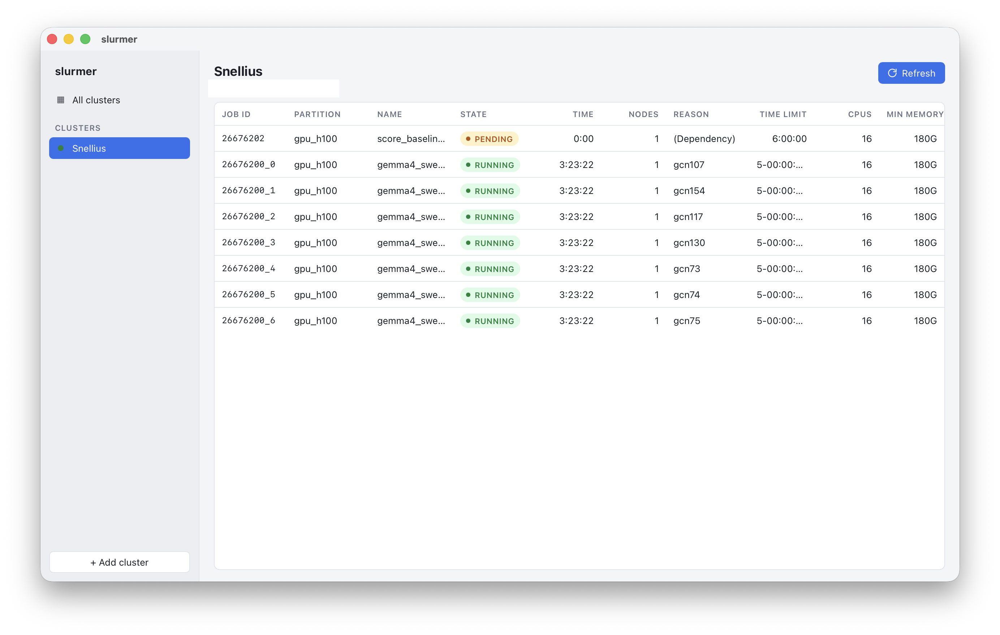

# slurmer

A small desktop app that shows your Slurm job queue on one or more HPC
clusters, fetched over ssh with a manual Refresh. Cross-platform port of
[Job Tracker](https://github.com/shawonashraf/jobtracker), written in Rust
with a native [gpui](https://gpui.rs) UI.



## Install

### macOS via Homebrew

```bash
brew install --cask shawonashraf/tap/slurmer
```

Needs macOS 11 or newer. Release builds are ad-hoc signed and not notarized;
the cask removes the quarantine attribute from `Slurmer.app` after installing,
so the app opens without the "damaged" Gatekeeper dialog and no manual `xattr`
step is needed. Later:

```bash
brew upgrade --cask slurmer     # move to the latest release
brew uninstall --cask slurmer   # remove the app, keep your saved clusters
brew uninstall --zap --cask slurmer   # also delete clusters.json and caches
```

### Other platforms and manual installs

Download a bundle from the [releases page](https://github.com/shawonashraf/slurmer/releases):
`.dmg` for macOS, `.deb`/`.AppImage` for Linux, `.msi`/`-setup.exe` for
Windows. On macOS, clear the quarantine flag after copying the app to
`/Applications`:

```bash
xattr -cr /Applications/Slurmer.app
```

## How it works

- Saved cluster profiles (name, ssh host, user) live in `clusters.json` under
  the app's config directory.
- Refresh runs the system `ssh` binary:
  `ssh -o User=<user> <host> squeue --noheader -u '<user>' -o '<format>'`.
  The host is used verbatim, so aliases from `~/.ssh/config` apply, including
  `ControlMaster` sockets and any 2FA session you already opened in a terminal.
- When User is left blank, the app omits `-o User=` and runs `squeue --me`
  instead of `-u`, so the alias's own `User` line applies; `--me` needs
  Slurm 20.02 or newer.
- Output is parsed into a table with colour-coded job states.

If ssh needs an interactive login, open a terminal and run `ssh <host>` once,
then press Refresh again.

## Requirements

- An `ssh` client on your PATH (built in on macOS, Linux, and Windows 10+).
- ssh access to a Slurm cluster.

## Develop

```bash
cargo run                       # debug build of the app
cargo test                      # all tests (fetch tests are unix-only)
cargo clippy --all-targets -- -D warnings
cargo fmt --check
```

Linux needs the gpui build dependencies:
`libxkbcommon-dev libxkbcommon-x11-dev libwayland-dev libx11-xcb-dev
libxcb1-dev libfontconfig1-dev libfreetype6-dev libvulkan-dev`.

Set `SLURMER_CONFIG=/path/to/clusters.json` to run against a scratch config
instead of your real one.

## Build

```bash
cargo install cargo-packager --locked
cargo build --release --no-default-features   # macOS: precompiled shaders, needs Xcode's Metal Toolchain
cargo packager --release --formats app,dmg      # macOS; deb,appimage on Linux; nsis,wix on Windows
```

Bundles land in `target/release/`.

## Release

1. Bump `version` in `Cargo.toml`, commit, and push a matching `v*` tag.
2. The `release` workflow builds bundles for macOS (arm64 and x64), Linux and
   Windows with cargo-packager and attaches them to a draft GitHub release.
3. Publish the draft. That triggers the `homebrew` workflow, which downloads
   the two macOS dmgs, renders the cask with `scripts/homebrew-cask.sh`, and
   pushes it to
   [shawonashraf/homebrew-tap](https://github.com/shawonashraf/homebrew-tap).
   The cask in the tap is generated output; change the script, not the tap.
